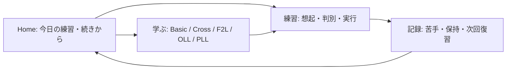

# CFOP Trainer：研究・現行指針との比較と改善提案

調査日：2026-10-25。対象：GitHub main `857d22c8510791957e7ae13d0cb95a8eaa308b1b`（v102）。GitHub接続でmainの一致を確認。ランタイムの変更・コミット・公開は行っていない。

## 1. 判断の要点と根拠の扱い

優先したいのは、**目的を選びやすい入口、試行履歴を伴う復習、認識と実行を分けた練習**。現在の静的配信、ローカル保存、アルゴリズムの独立モデル照合、1手送り・戻し・一時停止、トリガーの強調表示は活かせる。

研究・規格・教材は区別する。2026年の実験論文も確認したが、検索した一次資料による比較調査であり、網羅的なシステマティックレビューではない。CFOP Trainerそのものを使った学習効果の実験はしていない。

| 根拠 | 確認した内容 | このサイトへの意味・限界 |
|---|---|---|
| 2026-09-29、Serfaty、文法学習・14/56日後の保持 | 複数の無誤答セッション数と長期保持の関連を分析 | 一度の成功や自己チェックを長期習得と同一視しない参考。事後群分けによる予測であり、CFOPで「3回成功すれば習得」という因果的基準にはできない。[原著](https://onlinelibrary.wiley.com/doi/10.1002/acp.70290) |
| 2026-05-23、Gupta & Rickard、運動系列の2実験 | 短い休憩を挟んだ訓練中の成績差が、条件を揃えた後のテストではほぼ消失 | 記憶の復習間隔と、指の運動速度の上達を同じ理屈で扱わない。短い休憩・指タップ課題の結果を、日をまたぐCFOP練習全般へ拡張しない。[原著](https://www.nature.com/articles/s41598-026-52702-5) |
| W3C COGA、2021の補足指針、現行公開版を確認 | ページの目的を明示し、頻用操作までの経路を短くする | Homeの学習開始・復習再開を上部へ。これは認知アクセシビリティの指針であり、このサイトでの効果量を示す比較試験ではない。[目的](https://www.w3.org/WAI/WCAG2/supplemental/patterns/o1p01-clear-purpose/)、[短い経路](https://www.w3.org/WAI/WCAG2/supplemental/patterns/o5p02-short-paths/) |
| CubeSkillsの現行教材 | F2Lを概念・基本形・例題へ段階化し、その後に効率化や先読みを扱う | 初心者向けの「ペアを作る理由・スロットへ入る理由」を厚くする参考。専門家教材であり、唯一の最適順序を証明する実験ではない。[F2L](https://www.cubeskills.com/tutorials/f2l)、[中級練習](https://cubeskills.com/tutorials/intermediate-cross-and-f2l) |
| 2025、段階的な完成例に想起を組み込む無作為比較 | 成人164人、次の小ステップを提示前に想起する条件で1週間後の成績が良好 | 3Dのトリガー境界で「次を予測」する設計の参考。ただし学習時間約31分対13分、離脱差があり、キューブ課題・等時間での効果は未確認。[出版社](https://www.sciencedirect.com/science/article/pii/S0959475225001203)、[著者所属大学の全文](https://research-portal.uu.nl/ws/files/269108220/1-s2.0-S0959475225001203-main.pdf) |

学習研究の追加原著・実験条件は [学習研究メモ](LEARNING_RESEARCH_2026-10-25.md) を参照。

キューブに直接関係する最新候補として2026-09-11の [AK-cubieプレプリント](https://arxiv.org/abs/2609.12946) も確認した。ブロック構築の系列生成・練習ソフトの提案はあるが、初心者CFOPの学習効果の比較実験ではない。高度な先読み課題の候補として保留し、主要構成を切り替える根拠にはしない。

## 2. 学習構成の改善：優先する5件

P1＝次の改善で優先、P2＝P1の土台ができた後。工数は既存コードを使う実装・回帰確認の概算人時であり、研究結果ではない。項目間で重複する作業があるため単純合算しない。

| 順位 | 改善案・現状の根拠 | 具体的な内容 | 期待する効果 / 工数 |
|---|---|---|---|
| P1-1 | Homeに「今日の練習」「続きから」を置く。現状はフロー→スクランブル→フリープレイ→クイズの順。[index.html:58](https://github.com/fenderian075-cpu/cfop/blob/857d22c8510791957e7ae13d0cb95a8eaa308b1b/index.html#L58)、[132](https://github.com/fenderian075-cpu/cfop/blob/857d22c8510791957e7ae13d0cb95a8eaa308b1b/index.html#L132) | 初回は「記号を学ぶ／初心者CFOP／覚えた手順を復習」の目的選択。再訪時は前回の続き・復習期限を優先。既存6分野は教材目次に残す。 | 練習開始時の迷いを減らす。効果はCOGAからの設計上の推論。8–16時間。 |
| P1-2 | 習得を履歴へ拡張。現状はIDを持つSetの自己チェックだけ。[progress.js:3](https://github.com/fenderian075-cpu/cfop/blob/857d22c8510791957e7ae13d0cb95a8eaa308b1b/progress.js#L3) | ケース・日時・課題種別・ヒント使用・自己評価／自動判定の別・回答時間・次回予定を保存。「見た」「思い出せた」「実物で回せた」を区別。既存のチェック済み状態は保持して移行する。 | 苦手・忘却を見つけ、復習を選べる。翌日・後日の保持を測る土台。20–32時間。 |
| P1-3 | クイズを「覚える→見分ける→混ぜる」へ。現状は対象プールの一様ランダム抽選。[app.js:70](https://github.com/fenderian075-cpu/cfop/blob/857d22c8510791957e7ae13d0cb95a8eaa308b1b/app.js#L70)、[88](https://github.com/fenderian075-cpu/cfop/blob/857d22c8510791957e7ae13d0cb95a8eaa308b1b/app.js#L88) | 未知の1ケースを例付きで練習→似たケース2つの違いを説明→学習済みと苦手を混ぜる。答えを表示する前に選択・想起を促す。F2Lは基本形のペア作り・挿入の説明と結び付ける。 | 概念理解とケース判別を助ける。混合の最適比率・開始条件は検証対象。16–28時間。 |
| P2-1 | 3Dに意味のまとまり単位の練習を追加。現状もトリガー強調と1手操作は存在。[build.js:312](https://github.com/fenderian075-cpu/cfop/blob/857d22c8510791957e7ae13d0cb95a8eaa308b1b/build.js#L312)、[player.js:288](https://github.com/fenderian075-cpu/cfop/blob/857d22c8510791957e7ae13d0cb95a8eaa308b1b/player.js#L288) | Tパームのトリガー区切りで一時停止、区間反復、速度選択、次に動くピースの予測。見るだけの例示から、ヒントを減らす実行課題へ進む。 | 長い系列を追いやすくする仮説。分割再生の一般研究からの転用であり、CFOP効果は未検証。12–24時間。 |
| P2-2 | 認識時間・実行時間・保持を別に表示。現状は手数と習得数が中心。[index.html:93](https://github.com/fenderian075-cpu/cfop/blob/857d22c8510791957e7ae13d0cb95a8eaa308b1b/index.html#L93) | ケース認識、記号想起、実物キューブ実行、全体ソルブを別メトリクスにする。実物の成功は手動記録と表示。3D自動再生完走をユーザーの技能として採点しない。 | 本人のボトルネックを判断できる。実行計時・手動記録の最小版12–20時間。 |

推奨する上位構成のたたき台：

これは研究が唯一の正解として指定するナビゲーションではない。現在の分野別目次を維持しながら、行動別の入口を加える設計仮説。まずHomeの上部だけで試せる。上級者の目次直行や自主選択も残し、レベル判定による教材の強制ロックは行わない。

## 3. 操作・コード・配信構成の改善：5件

| 優先 | 対象と現状の根拠 | 提案 / 根拠 / 検証方法 | 工数 |
|---|---|---|---|
| P1 | 実ブラウザでのモバイル回帰をCIへ。現CIはNodeテスト、Worker検証、audit、配布物作成。[ci.yml:16](https://github.com/fenderian075-cpu/cfop/blob/857d22c8510791957e7ae13d0cb95a8eaa308b1b/.github/workflows/ci.yml#L16)。タップのテストはcaptureをモデル化したDOM試験。[mobile.test.cjs:9](https://github.com/fenderian075-cpu/cfop/blob/857d22c8510791957e7ae13d0cb95a8eaa308b1b/tests/mobile.test.cjs#L9) | Chromiumのtouch profileとWebKitで、タップ、スワイプ、縦横、14手完走、リセット、英語、旧キャッシュからの更新を定期実行。[Playwright公式](https://playwright.dev/docs/emulation)。エミュレーションと実機確認は分ける。 | 12–20時間 |
| P2 | 視点回転のドラッグ代替。回転はドラッグ、単一ボタンは初期視点へ戻す機能。[player.js:72](https://github.com/fenderian075-cpu/cfop/blob/857d22c8510791957e7ae13d0cb95a8eaa308b1b/player.js#L72)、[solver.js:645](https://github.com/fenderian075-cpu/cfop/blob/857d22c8510791957e7ae13d0cb95a8eaa308b1b/solver.js#L645) | 左右・上下・背面などの視点ボタンを用意する。初期化だけでは自由回転の代替にならない。WCAG 2.2の2.5.7は原則としてドラッグ不要の単一ポインター代替を求める。[W3C](https://www.w3.org/WAI/WCAG22/Understanding/dragging-movements.html)。全体の適合判定は別監査。通常44px目標は維持するが、AAの最小基準は例外付き24px、44pxはAAA強化基準。[24px](https://www.w3.org/WAI/WCAG22/Understanding/target-size-minimum.html)、[44px](https://www.w3.org/WAI/WCAG22/Understanding/target-size-enhanced.html) | 6–12時間 |
| P2 | 学習データ、状態、描画、翻訳の責務。現在12本のdeferスクリプトの順序に依存。[index.html:490](https://github.com/fenderian075-cpu/cfop/blob/857d22c8510791957e7ae13d0cb95a8eaa308b1b/index.html#L490)。翻訳はTreeWalkerとMutationObserverを使用。[i18n.js:183](https://github.com/fenderian075-cpu/cfop/blob/857d22c8510791957e7ae13d0cb95a8eaa308b1b/i18n.js#L183) | 新しい試行履歴・復習計画は純粋な関数と明示的な依存を持つ小さなES Modulesから開始。翻訳はメッセージキー化を段階的に拡張。ケース定義には安定ID・概念・前提・トリガー・出典・版を持たせ、UIと分離。[MDN Modules](https://developer.mozilla.org/en-US/docs/Web/JavaScript/Guide/Modules)。静的配信を維持する。 | 最初の切り出し16–32時間 |
| P2 | 性能の計測と段階的初期化。モード変更で全教材・Freeplay等をrebuildする。[navigation.js:68](https://github.com/fenderian075-cpu/cfop/blob/857d22c8510791957e7ae13d0cb95a8eaa308b1b/navigation.js#L68) | 中程度のスマホ相当で初期表示・モード変更・英語切替の応答と長時間タスクを測る。その後に非表示教材の遅延描画や状態を保つ差分更新を判断。実ユーザーINPはmobile/desktop別75パーセンタイル200ms以下が目標。[web.dev、2025更新](https://web.dev/articles/optimize-inp)。現サイトのINPや速度改善率は今回測定していない。 | 計測4–8時間、最適化8–20時間 |
| P2 | 学習履歴を壊さない更新・保存。現保存コードはIDリストのみ。[app.js:128](https://github.com/fenderian075-cpu/cfop/blob/857d22c8510791957e7ae13d0cb95a8eaa308b1b/app.js#L128)。SWは既存タブが閉じるまで待機。[sw.js:35](https://github.com/fenderian075-cpu/cfop/blob/857d22c8510791957e7ae13d0cb95a8eaa308b1b/sw.js#L35) | schemaVersion付き履歴、移行処理、書き出し／読み込みの往復テスト、教材版とアプリ版の表示、更新待ちの案内を追加。練習中の強制リロードは避け、保存後の切替と複数タブ更新を実ブラウザで確認。[MDN SW](https://developer.mozilla.org/en-US/docs/Web/API/Service_Worker_API/Using_Service_Workers)。端末内保存と手動バックアップをまず整える。 | 12–24時間 |

既存のアルゴリズム性質テスト、Worker隔離、固定依存・ライセンス検証は維持する。React等への全面移行、AIコーチ、Bluetoothキューブ連携は、今回の研究比較から直ちに必要とは判断できない。必要性・利用者の課題・保守負担が具体化した時点で個別評価する。

## 4. 実装順序と効果確認

1. **回帰の土台**：モバイルブラウザCIを先に追加する。既存37テスト、旧版からの更新、保存コード互換を維持。
2. **最小の学習改善**：Homeの「続きから」、ケース別試行履歴、手動評価、簡単な復習キューを一組で試す。FSRS等の高度なスケジューラは、履歴と保持データが蓄積した後に単純方式と比較する。
3. **課題を分ける**：Tパームと少数の既存ケースで、認識・想起・実物実行を別課題にする。次に似たケースの比較と混合練習、区間反復を加える。
4. **測定して調整**：開始までのタップ数／離脱、ヒント前の回答、翌日と後日の保持、実物での実行を別々に確認。「3分」「数ケース」「復習間隔」は製品上の初期設定であり、研究が保証する最適値ではない。
5. **必要な範囲を整理**：計測した処理負荷と変更頻度に応じて遅延描画、翻訳キー、ES Modulesへ進める。学習効果は小規模な導線テストと区別し、適切な比較評価を行うまで改善率を公称しない。

実行時の受入条件は、従来の学習済みIDが残ること、JA/ENと簡易/本格で同じケース履歴が対応すること、別の日の復習が再現可能であること、3D鑑賞と本人の成功記録が混同されないこと、モバイルのタップ・スワイプと更新が回帰しないこと。
